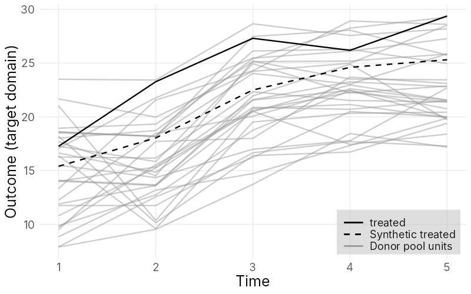
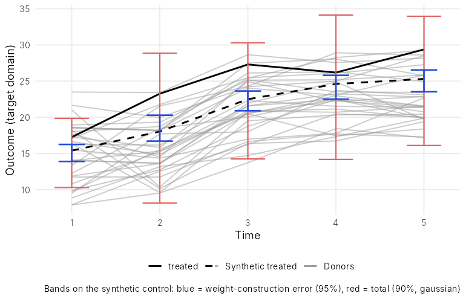
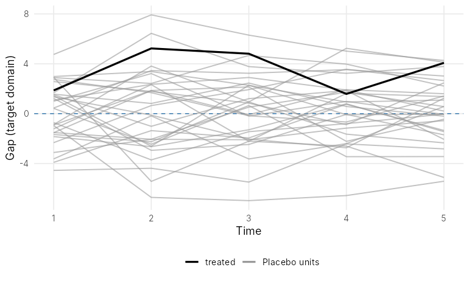

# causalpanelfusion

**causalpanelfusion** estimates the effect of an intervention on a single
treated unit when the outcome of interest (the *target domain*) has **no
pre-intervention period**. It fuses panel data from a related *reference
domain*, observed for the same units and unaffected by the intervention, so
that counterfactual outcomes can still be recovered.

It implements the methods of

> Yang, Z., Lee, S. H., Köhler, J. R. and Ghassami, A. *Causal Data Fusion for
> Panel Data without a Pre-Intervention Period.*
> [arXiv:2410.16391](https://arxiv.org/abs/2410.16391)

| | |
|---|---|
| **Synthetic control data fusion** | `scfusion()`: donor weights from a data-driven constrained optimisation in the reference domain, transported to the target domain |
| **Prediction intervals** | `scfusion_pi()`, `pi_bands()`: bootstrap of the weight-construction error + donor-placebo calibration of the transfer error (location-scale and sub-Gaussian constructions), average and per-period |
| **Diagnostics** | `covariate_balance()`, `placebo_test()` (in-space, leave-one-out), `rmspe_test()`, `eta_sensitivity()`, `sensitivity_pi()` |
| **Equi-confounding data fusion** | `equi_confounding()`: linear and logarithmic estimators |
| **Utilities** | `simulate_fusion_data()`, `panel_to_matrix()`, `covariate_matrix()`, `normalize_minmax()` |

## Installation

```r
# install.packages("remotes")
remotes::install_github("ZouYang31/causalpanelfusion", build_vignettes = TRUE)
```

No commercial solver is needed (see [Solvers and speed](#solvers-and-speed)).

## Usage

### The data

The package needs four matrices with **one row per unit** (the same units, in
any order, matched by row name):

| argument    | paper | content                                                        |
|-------------|-------|----------------------------------------------------------------|
| `target`    | *Y*   | target-domain outcomes, units × post-intervention periods      |
| `reference` | *F*   | reference-domain outcomes, units × periods (never treated)      |
| `X`         | *X*   | target-domain covariates, units × covariates                   |
| `Z`         | *Z*   | reference-domain covariates, units × covariates                |

The treated unit is given by row name or index through `treated`. The
example below uses data simulated from the paper's factor model: 31 units,
20 reference periods, 5 target periods, and a true average effect of 3.72.

```r
library(causalpanelfusion)

sim <- simulate_fusion_data(seed = 45)
sim$reference[1:3, 1:6]
#>             t1    t2    t3    t4    t5    t6
#> treated  15.66 26.28 14.56 20.17 25.03 30.78
#> donor_01  7.77 15.94 12.39  9.78 13.40 22.05
#> donor_02  8.71 17.04 11.90 13.26 15.84 24.00
sim$target[1:3, ]
#>             s1    s2    s3    s4    s5
#> treated  17.26 23.27 27.31 26.19 29.38
#> donor_01  8.85 13.18 14.72 17.34 19.88
#> donor_02  7.91 12.56 16.23 20.49 20.01
```

### 1. Estimate the effect

```r
fit <- scfusion(target = sim$target, reference = sim$reference,
                X = sim$X, Z = sim$Z, treated = "treated")
fit
#> Synthetic control data fusion
#>   treated unit: treated | donors: 30 | target periods: 5 | reference periods: 20
#>   estimated average effect (psi_hat): 3.5099
#>   donors with positive weight: 6
#> donor_17 donor_05 donor_16 donor_06 donor_18 donor_26
#>   0.2352   0.2234   0.2171   0.1797   0.0942   0.0504
```

`summary(fit)` reports the per-period effects, the selected budget, the fit
criteria and covariate balance:

```r
summary(fit)
#> Per-period effects (target domain):
#>  period treated synthetic effect
#>      s1   17.26     15.40  1.863
#>      s2   23.27     18.04  5.230
#>      s3   27.31     22.50  4.807
#>      s4   26.19     24.61  1.580
#>      s5   29.38     25.31  4.069
#>
#> Selected budget: b_F = 0.98, b_Z = 0.01, b_X = 0.01 (4796 of 4796 candidates feasible)
#> Fit: NSE_F = 1.793 | NSE_Z = 0.02792 (baseline 0.003333) | NSE_X = 0.01833 (baseline 8.796e-05)
#> ...
```

`plot(fit)` draws the target domain, and `plot(fit, type = "reference")` the
reference domain where the weights were fitted:



Useful options: `eta_Z`, `eta_X` (balance slack, default 0.1),
`budget_step` (grid spacing, default 0.01), `solver` (`"ecos"` or
`"gurobi"`).

**Covariate balance.** `covariate_balance()` compares the treated unit with
its synthetic control and the donor pool on every covariate, in both
domains:

```r
covariate_balance(fit)
#> Covariate balance: treated vs its synthetic control (fitting-scale units)
#>
#>         domain covariate treated synthetic donor_mean donor_min donor_max      gap treated_rank
#>  reference (Z)        Z1  0.8072    0.8848     0.5717  0.004897    0.9856 -0.07761           10
#>  reference (Z)        Z2  0.9783    0.7569     0.5139   0.05591    0.8899   0.2214            1
#>  reference (Z)        Z3  0.7103    0.5408     0.4158   0.02047    0.9998   0.1695            9
#>     target (X)        X1  0.6351    0.6565     0.4451  0.006789    0.9892  -0.0214           11
#>     target (X)        X2   0.911    0.7004     0.5371   0.01903    0.9955   0.2106            6
#>     target (X)        X3  0.2693    0.3701     0.4291   0.03893    0.8215  -0.1009           21
#>
#> treated_rank: 1 = largest of 31 units.
#> Fitting-scale discrepancy NSE (fitted | best attainable | allowed):
#>   reference: 0.0279 | 0.00333 | 0.104
#>   target:    0.0183 | 8.8e-05 | 0.1
```

`treated_rank` flags covariates on which the treated unit sits at the edge
of the donor pool (rank 1 = largest), where no weighted average of donors can
match it closely. The footer compares the fitted discrepancies with the best
attainable values and the limits allowed by `eta_Z` and `eta_X`. Pass
covariates in their original units through `X` and `Z` to report the table
in those units, and other fits through `compare` to show them side by side
(see [Using your own data](#using-your-own-data)).

### 2. Prediction intervals

`scfusion_pi()` bootstraps the weight-construction error (re-running the
whole algorithm, including the budget search) and calibrates the transfer
error from donor placebos. The nominal level is `1 - alpha1 - alpha2`.

```r
pi <- scfusion_pi(fit, alpha1 = 0.05, alpha2 = 0.05, B = 200,
                  budget_step = 0.05, seed = 1)
pi
#>                      method   approach level estimate   lower   upper   width
#>              in-sample only diagnostic   95%   3.5099  2.3122  4.9424  2.6302
#>   location-scale (Gaussian) Approach 2   90%   3.5099 -3.7708 11.0253 14.7961
#>  location-scale (empirical) Approach 2   90%   3.5099 -1.2463 10.3690 11.6152
#>          sub-Gaussian bound Approach 1   90%   3.5099 -6.1179 13.3724 19.4903
```

Pointwise bands for each target period (`method = "gaussian"`,
`"empirical"` or `"subgaussian"`):

```r
pi_bands(pi, method = "gaussian")
#>   period treated synthetic total_lo total_hi effect effect_lo effect_hi
#> 1     s1    17.3      15.4    10.30     19.9   1.86     -2.60      6.96
#> 2     s2    23.3      18.0     8.15     28.9   5.23     -5.60     15.12
#> 3     s3    27.3      22.5    14.25     30.3   4.81     -2.99     13.06
#> 4     s4    26.2      24.6    14.18     34.1   1.58     -7.95     12.01
#> 5     s5    29.4      25.3    16.11     34.0   4.07     -4.58     13.27

plot(pi)                    # bands on the synthetic control
plot(pi, type = "effect")   # per-period effects with bands
```



The transfer error is not identified nonparametrically, so
`sensitivity_pi()` shows how the interval grows as its scale is multiplied by
ρ (ρ = 0 keeps only the weight-construction error):

```r
sensitivity_pi(pi, rho = c(0, 0.5, 1, 2))
#>   rho scale estimate  lower upper
#> 1 0.0  0.00     3.51  2.312  4.94
#> 2 0.5  1.55     3.51 -0.729  7.98
#> 3 1.0  3.10     3.51 -3.771 11.03
#> 4 2.0  6.21     3.51 -9.854 17.11
```

### 3. Diagnostics

**In-space placebos**: every donor in turn is treated as if it were the
treated unit:

```r
pl <- placebo_test(fit)
plot(pl)                         # target-domain gaps
plot(pl, domain = "reference")   # reference-domain gaps
```



The **RMSPE-ratio test** turns the placebos into an exact p-value, with the
reference-domain fit playing the role of the pre-period:

```r
rmspe_test(fit)
#> ...
#> Treated unit (treated) rank: 4 of 31 -> exact placebo p-value = 0.129
```

**Leave-one-out**: drop each positive-weight donor in turn:

```r
placebo_test(fit, type = "leave_one_out")
#>          unit    role average_gap rmspe_reference rmspe_target
#>  (all donors) treated       3.510           1.339        3.821
#>      donor_05 placebo       3.752           1.442        4.041
#>      donor_06 placebo       3.985           1.364        4.311
#>      donor_16 placebo       3.895           1.399        4.277
#>      donor_17 placebo       2.913           1.367        3.283
#>      donor_18 placebo       3.863           1.355        4.159
#>      donor_26 placebo       3.203           1.345        3.506
```

**Balance slack**: refit over a grid of `eta_Z` × `eta_X`:

```r
es <- eta_sensitivity(fit, eta_Z = c(0.05, 0.1, 0.2), eta_X = c(0.05, 0.1, 0.2))
plot(es)   # heat map of the estimate
```

### 4. Equi-confounding data fusion

```r
ec <- equi_confounding(sim$target, sim$reference, treated = "treated")
ec
#> Equi-confounding data fusion
#>   linear:     psi_hat = 1.6277
#>   logarithmic: psi_hat = 2.2327
plot(ec)
```

### Using your own data

Data usually come in long format. `panel_to_matrix()` and
`covariate_matrix()` build the four inputs. Rows are matched by unit name, so
the files can be in any order. For example:

```
# outcomes.csv: one row per unit, domain and period
unit,domain,period,outcome
unit_A,reference,2021-01,12.3
unit_A,target,2021-01,17.5
unit_B,reference,2021-01,9.0
...

# covariates.csv: one row per unit and domain
unit,domain,median_income,median_age,proportion
unit_A,reference,84443,30.1,0.77
unit_A,target,51210,27.9,0.35
...
```

```r
outcomes   <- read.csv("outcomes.csv")
covariates <- read.csv("covariates.csv")

reference <- panel_to_matrix(subset(outcomes, domain == "reference"),
                             unit = "unit", time = "period", outcome = "outcome")
target    <- panel_to_matrix(subset(outcomes, domain == "target"),
                             unit = "unit", time = "period", outcome = "outcome")

vars <- c("median_income", "median_age", "proportion")
Z <- covariate_matrix(subset(covariates, domain == "reference"),
                      unit = "unit", covariates = vars, normalize = TRUE)
X <- covariate_matrix(subset(covariates, domain == "target"),
                      unit = "unit", covariates = vars, normalize = TRUE)

fit <- scfusion(target, reference, X = X, Z = Z, treated = "unit_A")
```

`normalize = TRUE` min-max scales each covariate to [0, 1], as in the paper,
so that covariates on different scales are balanced comparably. To read the
covariate balance in the original units, build the same matrices without
normalising and pass them to `covariate_balance()`; `compare` adds the
synthetic values of other fits as extra columns:

```r
X_raw <- covariate_matrix(subset(covariates, domain == "target"),
                          unit = "unit", covariates = vars)
Z_raw <- covariate_matrix(subset(covariates, domain == "reference"),
                          unit = "unit", covariates = vars)
covariate_balance(fit, X = X_raw, Z = Z_raw)

fit_tight <- scfusion(target, reference, X = X, Z = Z, treated = "unit_A",
                      eta_X = 0.01)
covariate_balance(fit, X = X_raw, Z = Z_raw,
                  compare = list(eta_X_0.01 = fit_tight))
```

See `vignette("causalpanelfusion")` for a longer walk-through.

## Solvers and speed

The optimisation uses the free [ECOS](https://github.com/embotech/ecos)
solver. If you have a Gurobi licence, `solver = "gurobi"` reproduces the
original research implementation exactly.

One fit with the default budget grid takes a few seconds. Prediction
intervals and placebo tests refit the model many times, so they are the slow
steps (with `B = 500`, roughly 500 fits). Run the refits in parallel; the
results are identical to a serial run:

```r
future::plan(future::multisession)
pi <- scfusion_pi(fit, parallel = TRUE, seed = 1)
pl <- placebo_test(fit, parallel = TRUE)
```

For quick exploration, `budget_step = 0.05` (refits only) or
`reselect_budget = FALSE` give faster approximations.

## Interpreting the intervals

The intervals are feasible plug-in versions of the paper's oracle intervals:
the transfer scale is estimated from a small number of donor placebos and its
estimation error is not propagated, and the identifying assumptions are
maintained rather than tested. With `bias_allowance = 0` (default) they
target the effect plus the conditional transfer bias; supply a valid bound
through `bias_allowance` to target the effect itself.

## Citation

```r
citation("causalpanelfusion")
```
